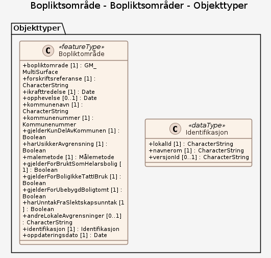
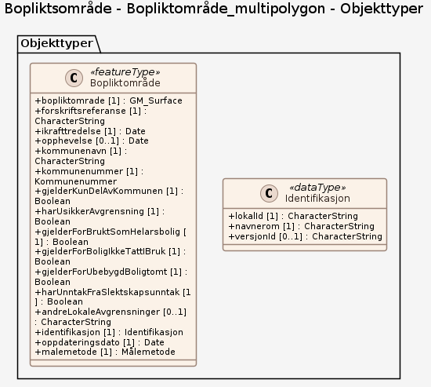

# Produktspesifikasjon: Bopliktsområde

*Konsesjonsområder for boplikt*

**Nøkkelord:** 

**Emnekategorier:** 

## Om spesifikasjonen

> **Denne versjonen av produktspesifikasjonen:**  
> **Opprettet dato:**  
> **Endret dato:**  
> **Språk:**  
> **Kontaktinformasjon:** Landbruksdirektoratet

## Om produktet Bopliktsområde

> **Romlig representasjonstype:**  
> **Unik identifikator:**  
> **Kontaktinformasjon:** Landbruksdirektoratet, 
>
> **Romlig oppløsning:**
>
>
>
> **Begrensninger:**

## Omfang

### Hele datasettet

**Nivå**: dataset

**Nivåbeskrivelse**: Gjelder hele datasettet. Hvis omfang ikke er oppgitt under en overskrift, gjelder teksten for hele datasettet og alle leveranser

### Bopliktsområder

**Nivå**: dataset

**Nivåbeskrivelse**: Datamodell (SOSI UML (XMI))

### Bopliktområde_multipolygon

**Nivå**: dataset

**Nivåbeskrivelse**: Bopliktsområder med multipolygoner

## Datainnhold og struktur

### Datamodell - Bopliktsområder

➡️ [Se full datamodell for omfang "Bopliktsområder" (diagram per pakke og objektkatalog)](bopliktsomrader/objektkatalog.html)

### Datamodell - Bopliktområde_multipolygon

➡️ [Se full datamodell for omfang "Bopliktområde_multipolygon" (diagram per pakke og objektkatalog)](bopliktomrade-multipolygon/objektkatalog.html)

## Leveranse

| Tjeneste | Endepunkt | Type | Format | Leveranseenheter |
| --- | --- | --- | --- | --- |
| GeoPackage: bopliktomrade-multipolygon | [Lenke](https://raw.githubusercontent.com/larsingea/ps_test/main/produktspesifikasjon/bopliktsomrade/bopliktomrade-multipolygon/bopliktomrade-multipolygon.gpkg) | Nedlasting | GPKG |  |
| GeoPackage: bopliktsomrader | [Lenke](https://raw.githubusercontent.com/larsingea/ps_test/main/produktspesifikasjon/bopliktsomrade/bopliktsomrader/bopliktsomrader.gpkg) | Nedlasting | GPKG |  |
| GML/XSD-skjema: bopliktomrade-multipolygon | [Lenke](https://raw.githubusercontent.com/larsingea/ps_test/main/produktspesifikasjon/bopliktsomrade/bopliktomrade-multipolygon/schema/xsd/INPUT/bopliktomrade-multipolygon.xsd) | Nedlasting | XSD |  |
| GML/XSD-skjema: bopliktsomrader | [Lenke](https://raw.githubusercontent.com/larsingea/ps_test/main/produktspesifikasjon/bopliktsomrade/bopliktsomrader/schema/xsd/INPUT/bopliktsomrader.xsd) | Nedlasting | XSD |  |
| JSON Schema: bopliktomrade-multipolygon | [Lenke](https://raw.githubusercontent.com/larsingea/ps_test/main/produktspesifikasjon/bopliktsomrade/bopliktomrade-multipolygon/schema/jsonschema/INPUT/bopliktomrademultipolygon/bopliktomrade-multipolygon.json) | Nedlasting | JSON Schema |  |
| JSON Schema: bopliktsomrader | [Lenke](https://raw.githubusercontent.com/larsingea/ps_test/main/produktspesifikasjon/bopliktsomrade/bopliktsomrader/schema/jsonschema/INPUT/bopliktsomrader/bopliktsomrader.json) | Nedlasting | JSON Schema |  |

