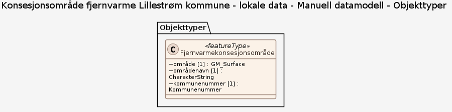

### Datamodell

**Kilde:** [JSON Schema](inputs/konsesjonsomrade-fjernvarme-lillestrom-kommune-lokale-data/manuell-datamodell.feature_types.json)

#### Fjernvarmekonsesjonsområde

Område der det er gitt konsesjon for fjernvarme etter energiloven, i Lillestrøm kommune.

Egenskaper

<table class="feature-attribute-table">
  <thead>
    <tr>
      <th>Egenskap</th>
      <th>Beskrivelse</th>
      <th>Type</th>
      <th>Multiplisitet</th>
    </tr>
  </thead>
  <tbody>
    <tr>
      <td>område</td>
      <td>Konsesjonsområdets geografiske utstrekning som flate.</td>
      <td>GM_<wbr />Surface</td>
      <td>1</td>
    </tr>
    <tr>
      <td>områdenavn</td>
      <td>Navn på konsesjonsområdet, f.eks. tettstedet området dekker.</td>
      <td>Character<wbr />String</td>
      <td>1</td>
    </tr>
    <tr>
      <td>kommunenummer</td>
      <td>Firesifret kommunenummer der de to første sifrene angir fylkestilhørighet.</td>
      <td><a href="#kodeliste-kommunenummer">Kommunenummer</a> (enumerering)</td>
      <td>1</td>
    </tr>
  </tbody>
</table>

### Kodelister

#### «Enumeration» Kommunenummer

Profilparametre i tagged values

<table class="feature-attribute-table">
  <colgroup>
    <col style="width: 35%;" />
    <col style="width: 65%;" />
  </colgroup>
  <tbody>
    <tr>
      <th scope="row">asDictionary</th>
      <td>false</td>
    </tr>
  </tbody>
</table>

Koder

<table class="code-list-table">
  <thead>
    <tr>
      <th>Kodenavn:</th>
      <th>Definisjon:</th>
      <th>Kodeverdi:</th>
    </tr>
  </thead>
  <tbody>
    <tr>
      <td></td>
      <td>Lillestrøm</td>
      <td>3205</td>
    </tr>
    <tr>
      <td></td>
      <td>Strømmen</td>
      <td>3206</td>
    </tr>
  </tbody>
</table>
