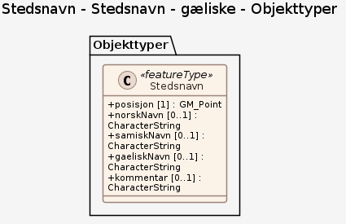

# Produktspesifikasjon: Stedsnavn

*Stedsnavn på geografiske detaljer basert på kartseriene Norge 1:50 000, økonomisk kartverk, sjøkart og navnevedtak gjort etter lov 18. mai 1990 nr.11 om stadnamn. Hvert navn har opplysninger om språk/språkform, koordinater for posisjon (punkt) , kommunetilhørighet, temakode for navnetype, vedtakstype, dato for registrering av navnevedtak og i hvilken sammenheng navnet er benyttet.*

**Nøkkelord:** Stedsnavn, ssr, sentralt stedsnavnsregister, navn, Kulturminne, kulturminner, beredskapsbase, Inspire, Det offentlige kartgrunnlaget, geodataloven, Norge digitalt, modellbaserteVegprosjekter, fellesDatakatalog, Basis geodata, stadnamn, namn, named place, placename, Sted, Skrivemåte, navnesakstatus, navnestatus, språk, stedsnavnnummer, navneobjekthovedgruppe, navneobjektgruppe, navneobjekttype, stedstatus, stedsnummer, skrivemåtenummer, skrivemåtestatus, prioritertSkrivemåte, Norge

**Emnekategorier:** Basisdata

**Geografisk utstrekning**:

- **Vest**: 4.50865119023897
- **Øst**: 33.2917009125465
- **Sør**: 57.67656966327455
- **Nord**: 71.23249032941354

**Geografisk område**:
Norge, fastland, Norske havområder

**Tidsmessig utstrekning**:

- **Tidsperiode**:
  - **Fra**: 2004-01-01
  - **Til**: 2026-11-13

## Om spesifikasjonen

> **Denne versjonen av produktspesifikasjonen:**  
> **Opprettet dato:** 2004-01-01 
> **Endret dato:** 2026-11-13 
> **Språk:** nor 
> **Kontaktinformasjon:** Kartverket, [kundesenter@kartverket.no](mailto:kundesenter@kartverket.no)

## Om produktet Stedsnavn

> **Romlig representasjonstype:** Vektor 
> **Unik identifikator:** <https://data.geonorge.no/sosi/stedsnavn/stedsnavn_forenklet> 
> **Kontaktinformasjon:** Kartverket, [kundesenter@kartverket.no](mailto:kundesenter@kartverket.no)
>
> **Romlig oppløsning:**
>
> **Ekvivalent målestokk**: 50000
>
> **Begrensninger:**
>
> **Ressursbegrensninger**:
>
> - **Bruksbegrensninger**: Ingen begrensninger på bruk er oppgitt.
>
> **Juridiske begrensninger**:
>
> - **Tilgangsbegrensninger**: Åpne data
> - **Bruksbegrensninger**: Lisens
> - **Lisens**: Creative Commons BY 4.0 (CC BY 4.0)
> - **Lisenslenke**: <https://creativecommons.org/licenses/by/4.0/>
> - **Andre begrensninger**: Dataene kan lastes ned og benyttes av alle kostnadsfritt i tråd med creative commons by 3.0.
>
> **Sikkerhetsbegrensninger**:
>
> - **Klassifisering**: Ugradert

### Formål

Dataene skal være grunnlag for forvaltning av stedsnavn etter «Lov om stadnanm» og samtidig
være et primærdatasett for stedsnavn i bruk i Kartverkets produkter.
Datasettet er også en forenkling av stedsnavnsdataene for å være med håndterbare som offlinedata.

### Bruksområde

Analyse og presentasjon i GIS-system. Presentasjon av statistikk og analyser. Produksjon av kart og avledede produkter. Grunnlag for kart- og lokasjonstjenester på Internett. Forskning undervisning. Slektsforskning oppslagsregister.

## Omfang

### Hele datasettet

**Nivå**: dataset

**Nivåbeskrivelse**: Gjelder hele datasettet. Hvis omfang ikke er oppgitt under en overskrift, gjelder teksten for hele datasettet og alle leveranser

### Stedsnavn - gæliske

**Nivå**: dataset

**Nivåbeskrivelse**: Datamodell (Manuell datamodell)

## Datainnhold og struktur

### Datamodell - Stedsnavn - gæliske

➡️ [Se full datamodell for omfang "Stedsnavn - gæliske" (diagram per pakke og objektkatalog)](stedsnavn-gliske/objektkatalog.html)

## Referansesystem

| EPSG-kode | Navn på referansesystem |
| --- | --- |
| [EPSG:25832](https://epsg.io/25832) | [EUREF89 UTM sone 32, 2d](https://register.geonorge.no/epsg-koder) |
| [EPSG:25833](https://epsg.io/25833) | [EUREF89 UTM sone 33, 2d](https://register.geonorge.no/epsg-koder) |
| [EPSG:25835](https://epsg.io/25835) | [EUREF89 UTM sone 35, 2d](https://register.geonorge.no/epsg-koder) |
| [EPSG:3035](https://epsg.io/3035) | [EUREF89 / ETRS89-LAEA Europe](https://register.geonorge.no/epsg-koder) |
| [EPSG:4258](https://epsg.io/4258) | [EUREF 89 Geografisk (ETRS 89) 2d](https://register.geonorge.no/epsg-koder) |

## Datakvalitet

**Nivå**: dataset

**Kvalitetsmål**: COMMISSION REGULATION (EU) No 1089/2010 of 23 November 2010 implementing Directive 2007/2/EC of the European Parliament and of the Council as regards interoperability of spatial data sets and services

- **Beskrivende resultat**: Dataene er ikke iht produktspesifikasjonen

**Kvalitetsmål**: SOSI produktspesifikasjon: Stedsnavn for vanlig bruk

- **Beskrivende resultat**: Dataene er i henhold til produktspesifikasjonen

**Kvalitetsmål**: Sosi applikasjonsskjema

- **Beskrivende resultat**: SOSI-filer er i henhold til applikasjonsskjema

**Kvalitetsmål**: Sosi applikasjonsskjema

- **Beskrivende resultat**: GML-filer er i henhold til applikasjonsskjema

**Kvalitetsmål**: Prosentvis oppfyllelse av FAIR-prinsipper

- **Målebeskrivelse**: Angir fullstendighet i forhold til krav fra FAIR-prinsippene (The FAIR Guiding Principles for scientific data management and stewardship)
- **Resultat**: 95

## Vedlikehold

**Vedlikeholdsfrekvens**: Kontinuerlig

**Status**: Kontinuerlig oppdatert

## Presentasjon

**navn**: Tegneregler

**Lenke**:
<https://register.geonorge.no/register/versjoner/tegneregler/kartverket/stedsnavn>

## Leveranse

| Tjeneste | Endepunkt | Type | Format | Leveranseenheter |
| --- | --- | --- | --- | --- |
| Geonorge nedlastning | [Lenke](https://nedlasting.geonorge.no/api/capabilities/30caed2f-454e-44be-b5cc-26bb5c0110ca) | GEONORGE:DOWNLOAD | FGDB, GML, PostGIS, SOSI | fylkesvis, kommunevis, landsfiler |
| Atom Feed | [Lenke](http://nedlasting.geonorge.no/geonorge/ATOM-feeds/Stedsnavn_AtomFeedFGDB.xml) | W3C:AtomFeed | FGDB | fylkesvis, kommunevis, landsfiler |
| Atom Feed | [Lenke](http://nedlasting.geonorge.no/geonorge/ATOM-feeds/Stedsnavn_AtomFeedGML.xml) | W3C:AtomFeed | GML | fylkesvis, kommunevis, landsfiler |
| Atom Feed | [Lenke](http://nedlasting.geonorge.no/geonorge/ATOM-feeds/Stedsnavn_AtomFeedSOSI.xml) | W3C:AtomFeed | SOSI | fylkesvis, kommunevis, landsfiler |
| Stedsnavn WMS | [Lenke](https://wms.geonorge.no/skwms1/wms.stedsnavnenkel?version=1.3.0&service=wms&request=getcapabilities) | WMS-tjeneste | png |  |
| GeoPackage: stedsnavn-gliske | [Lenke](https://raw.githubusercontent.com/larsingea/ps_test/main/produktspesifikasjon/stedsnavn/stedsnavn-gliske/stedsnavn-gliske.gpkg) | Nedlasting | GPKG |  |
| JSON Schema: stedsnavn-gliske | [Lenke](https://raw.githubusercontent.com/larsingea/ps_test/main/produktspesifikasjon/stedsnavn/stedsnavn-gliske/schema/jsonschema/INPUT/stedsnavngliske/stedsnavn-gliske.json) | Nedlasting | JSON Schema |  |

## Metadata

**Metadatastandard**: ISO19115

**Metadatastandardversjon**: 2003

**Metadatadato**: 2026-11-16

**språk**: nor

**Kontakt**:

- **Organisasjon**: Kartverket
- **Kontaktperson**: Ben Worsley
- **Logo**: <https://register.geonorge.no/data/organizations/971040238_Kartverket_liten.png>
- **Epost**: kundesenter@kartverket.no
- **rolle**: pointOfContact

**Metadataidentifikator**:

- **Utsteder**: Geonorge
- **kode**: 30caed2f-454e-44be-b5cc-26bb5c0110ca
- **koderom**: <https://kartkatalog.geonorge.no/metadata/>
- **Metadatalenke**: <https://kartkatalog.geonorge.no/metadata/30caed2f-454e-44be-b5cc-26bb5c0110ca>

## Tilleggsinformasjon

Trenger du hjelp til å laste ned og ta i bruk Kartverkets data og tjenester? På kartverket.no finner du tips og veiledning.

- **Produktark:** [https://register.geonorge.no/register/versjoner/produktark/kartverket/navn-fra-sentralt-stedsnavnregister](https://register.geonorge.no/register/versjoner/produktark/kartverket/navn-fra-sentralt-stedsnavnregister)
